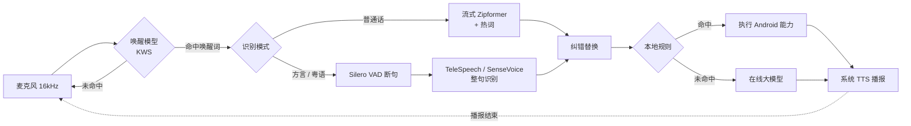

<p align="center">
  
</p>

<h1 align="center">Hark · 离线 Android 语音助手</h1>

Hark（古英语「听！」）是一个面向手机和平板车机的语音助手。助手的名字跟着唤醒词走：喊「小晏小晏」它就是小晏，喊「小海小海」就是小海，叠词取一半作名字，其他唤醒词原样使用（如「小晏同学」）。

基于 [sherpa-onnx](https://github.com/k2-fsa/sherpa-onnx) 的端侧语音助手。说「小晏小晏」「小海小海」或「小章小章」唤醒，助手播报「我在」并弹出胶囊浮窗，然后说指令即可。**唤醒和识别默认全程离线**，录音不会离开手机（只有手动切到讯飞云端听写模式时，唤醒后的指令录音才会上传给讯飞）；常用的手机控制指令由本地规则直接执行，只有本地匹配不上的问题，才会把识别出的**文字**发给在线大模型（默认 DeepSeek，可以换成其他服务商，也可以关闭）。

## 使用截图

<table>
  <tr>
    <td align="center"></td>
    <td align="center"></td>
    <td align="center"></td>
  </tr>
  <tr>
    <td align="center">本地指令：「打开手电筒」<br>规则命中，直接执行并播报</td>
    <td align="center">在线大模型：「为什么天空是蓝色的」<br>本地没匹配上，交给 DeepSeek 回答</td>
    <td align="center">调试面板<br>引擎启动，等待唤醒</td>
  </tr>
</table>

截图来自一加 7 Pro（手机模式，胶囊浮窗在屏幕底部）。

## 当前能力

| 能力 | 说明 |
|---|---|
| 自定义语音唤醒 | 默认三个唤醒词：「小晏小晏」「小海小海」「小章小章」，可改成任意中文词，数量不限 |
| 普通话流式识别 | 边说边出字，说完停顿后自动断句 |
| 方言识别 | TeleSpeech：川、粤、闽、吴、湘等 30 多种方言；SenseVoice：粤语、普通话、英、日、韩，自动识别语种 |
| 关键词识别调优 | 热词加权（普通话模式）、识别结果纠错替换（所有模式）、唤醒阈值/增强分实时可调 |
| 语音浮窗 | 唤醒后播报「我在」，弹出胶囊浮窗：波浪随说话音量起伏，边说边出字，再显示回复 |
| 连续对话 | 回复播完后继续听几秒（默认 6 秒），期间不用再喊唤醒词；说「退出」「没事了」或点一下胶囊即可结束 |
| 本地指令 | 手电筒、音量、亮度、媒体播放、打开应用、导航、计时器、闹钟、WiFi / 蓝牙设置、回桌面、拨号、时间日期 |
| 在线大模型 | 本地规则没匹配上的句子交给大模型回答（OpenAI 兼容接口，DeepSeek、通义、豆包、Kimi、智谱可选），支持多轮上下文 |
| 车机 / 手机两套话术 | 设置里选设备形态：车机回复短、浮窗在屏幕顶部；手机回复更口语化、浮窗在底部 |
| 语音回复 | 调用系统 TTS 播报，播报期间暂停收音，防止自己唤醒自己 |
| 后台常驻 | 前台服务 + WakeLock，退到后台或息屏后仍能唤醒 |
| 声纹校验 | 可选：谁说的唤醒词就只听谁的指令，车里其他人聊天不会被当成指令，不用提前录入声纹 |
| 调试工具 | 实时电平、识别文本、运行日志、唤醒计数、唤醒测试模式，每条指令自动保存录音；回放上一句、人工标注识别对错和正确文本 |

## 运行环境

### 最低配置

| 项目 | 要求 |
|---|---|
| 系统 | Android 8.0（API 26）及以上 |
| CPU 架构 | arm64-v8a（APK 只打包了 64 位 ARM 库） |
| 存储 | 只用普通话约 200 MB；四个模型全装约 770 MB |
| 内存 | 建议 4 GB 及以上（见下方说明） |
| 麦克风 | 手机自带麦克风即可，16 kHz 单声道采集 |
| 网络 | 不需要（下载模型时除外） |
| GPU / NPU | 不需要，纯 CPU 推理 |

> **内存说明**：同一时刻只加载「唤醒模型 + 当前模式的一个识别模型」。int8 模型在内存里的占用大致等于文件大小加上推理时的缓冲区：普通话模式约 200 至 300 MB，TeleSpeech 模式约 400 MB。这是根据模型体积估算的，尚未在设备上实测。

### 已验证设备

| 设备 | SoC | 系统 | 结果 |
|---|---|---|---|
| OnePlus 7 Pro（GM1910） | 骁龙 855 | Android 12 / ColorOS | 全部功能可用 |

该设备上的实测耗时：

| 环节 | 耗时 |
|---|---|
| 加载唤醒模型 | 约 0.2 s |
| 加载普通话流式模型 | 约 4.7 s |
| 加载 TeleSpeech | 约 1.3 s |
| 加载 SenseVoice | 约 1.5 s |
| 方言模式整句解码（2 至 3 秒语音） | 约 0.2 s |

### 开发环境

- JDK 17 及以上（Android Studio 自带的 JBR 即可）
- Android SDK：compileSdk 35
- Gradle 9.3.1（仓库里带了 wrapper）、Android Gradle Plugin 9.0.0
- `adb`、`curl`、`tar`：推送模型时使用
- Python 3 + `pypinyin`：只有重新生成拼音表时才需要

## 使用的模型

模型全部来自 sherpa-onnx 官方发布页，均为 int8 量化版本。为了方便替换和调参，**模型不打进 APK**，而是推送到手机的 `/sdcard/Android/data/com.raferlyan.hark/files/models/` 目录。

| 用途 | 模型 | 大小 | 结构 |
|---|---|---|---|
| 语音唤醒 | `sherpa-onnx-kws-zipformer-wenetspeech-3.3M-2024-01-01-mobile` | 约 5 MB | Zipformer transducer，3.3M 参数，拼音声韵母建模 |
| 普通话流式识别 | `sherpa-onnx-streaming-zipformer-zh-int8-2025-06-30` | 约 167 MB | 流式 Zipformer transducer（multi-zh-hans 数据训练），按字建模 |
| 方言识别 | `sherpa-onnx-telespeech-ctc-int8-zh-2024-06-04` | 约 341 MB | 中国电信 TeleSpeech，CTC，覆盖 30 多种方言 |
| 粤语 / 多语种 | `sherpa-onnx-sense-voice-zh-en-ja-ko-yue-int8-2025-09-09` | 约 237 MB | 阿里 SenseVoice-Small，非自回归，自带语种识别和 ITN |
| 语音活动检测 | `silero_vad.onnx` | 0.6 MB | Silero VAD |
| 推理运行时 | `sherpa-onnx-1.13.8.aar` | 48 MB | 自带 ONNX Runtime 和 JNI 库（已放在 `app/libs/`） |

## 直接下载

不想自己编译的话，在 [Releases](https://github.com/raferlyan/Hark/releases) 页面下载安装包和模型：

| 文件 | 内容 | 是否必需 |
|---|---|---|
| `Hark-v*-arm64.apk`（v0.2.0 时叫 `XiaoYanAssistant-v0.2.0-arm64.apk`） | 安装包（不含大模型 key，在设置里填自己的 key） | 必需 |
| `hark-models-kws-vad.tar.gz` | 唤醒模型 + VAD | 必需 |
| `hark-models-asr-mandarin.tar.gz` | 普通话流式识别 | 用普通话模式或讯飞模式时（讯飞模式拿它断句、兜底） |
| `hark-models-telespeech.tar.gz` | 方言识别（TeleSpeech） | 用方言模式时 |
| `hark-models-sensevoice.tar.gz` | 粤语 / 多语种（SenseVoice） | 用 SenseVoice 模式时 |
| `hark-models-speaker.tar.gz` | 声纹模型（3D-Speaker CAM++） | 开声纹校验时（v0.4.0 起） |

每个模型包解压后都是一个 `models/` 目录，推送到手机即可：

```bash
adb install Hark-v*-arm64.apk
for f in hark-models-*.tar.gz; do tar xzf "$f"; done
adb push models /sdcard/Android/data/com.raferlyan.hark/files/
```

> 推送前要先装好 App 并打开一次，系统才会创建 `Android/data/com.raferlyan.hark` 目录。
>
> v0.2.0 的包名还是旧的 `com.xiaoyan.assistant`，装这个版本时，推送目录也要换成 `/sdcard/Android/data/com.xiaoyan.assistant/files/`。从 v0.3.0 起包名改为 `com.raferlyan.hark`，和旧版是两个不同的应用，不能覆盖升级。

## 快速开始

```bash
# 1. 编译
./gradlew assembleDebug

# 2. 安装（部分 ColorOS / MIUI 机型需要在手机上点「继续安装」）
adb install -r app/build/outputs/apk/debug/app-debug.apk

# 3. 下载并推送模型（首次会下载到 ~/sherpa-dl，之后复用）
tools/push_models.sh                 # 全部模型
tools/push_models.sh kws vad asr     # 只装唤醒 + 普通话
```

`push_models.sh` 支持的模型组有 `kws`、`asr`、`tele`、`sensevoice`、`vad`、`speaker`（声纹，约 27MB，只有开了声纹校验才用得到）。如果要换下载目录，设置环境变量 `MODEL_CACHE`。

4. 打开 App，录音权限选「**使用应用时允许**」（选「仅本次允许」的话，退到后台后权限会被收回）。
5. 在「交互 / 浮窗」一栏点「**授予悬浮窗权限**」并打开开关。浮窗和「打开应用」「导航」这类需要从后台弹出界面的指令都依赖这个权限。ColorOS / MIUI 还要在应用权限里打开「**后台弹出界面**」。想用语音调亮度的话，再点「授予修改系统设置」。
6. 选择设备形态（车机 / 手机）和识别模式，点「保存并(重)启动」。顶部状态变绿后，说任一唤醒词（如「小晏小晏」），听到「我在」后再说指令。

如果要用在线大模型，在 App 的「在线大模型」一栏填 API Key；调试时也可以写在 `local.properties` 里（这个文件不入库），编译时注入，App 里留空就会使用它：

```properties
llm.apiKey=sk-xxxx
```

不说话也能测意图：在调试面板的输入框里打字后点「发送」，或者用 adb：

```bash
adb shell am start -n com.raferlyan.hark/.MainActivity --es cmd 音量调到五十
```

## 语音浮窗与交互流程

```
说「小晏小晏」 → 播报「我在」，弹出胶囊 → 聆听（波浪跟随音量，实时出字）
  → 本地规则命中：直接执行，播报结果
  → 没命中：胶囊显示「思考中…」，请求大模型，播报回答
  → 播完后继续聆听 N 秒 → 有新指令就再走一轮；没人说话就收起胶囊，回到待唤醒
```

- **胶囊浮窗**：深色半透明底加渐变描边，分上下两层：
  - **用户区**：识别出的文字居中显示，背后铺一层彩色波带。波带只跟着用户说话出现：聆听时振幅跟随麦克风电平，思考时缓慢流动。
  - **助手区**：「我在」和回复都是纯文字，不带波浪。出现回复时，用户的话缩成上方一行小字，胶囊自动变高。回复最多显示 6 行（车机 3 行），完整内容以播报为准。
- **位置**：车机模式显示在屏幕顶部居中，宽约 560 dp；手机模式显示在底部。
- **结束会话**：说「退出」「再见」「没事了」「谢谢」，在聆听时点一下胶囊，或者等聆听超时，都会结束会话。
- **打断（二次指令）**：助手播报回复或等待大模型时，有两种方式插话：
  - 说唤醒词：立刻停止播报，不再播「我在」，直接进入聆听；
  - 点一下胶囊：效果相同。
  
  还没返回的大模型结果会被丢弃，不会在新一轮里突然播出来。
- **「我在」期间不收音**：播报时麦克风数据会被丢弃，聆听超时从播报结束后才开始计时。

| 参数 | 默认值 | 作用 |
|---|---|---|
| 设备形态 | 手机 | 车机 / 手机：决定回复话术、大模型提示词和浮窗位置 |
| 唤醒后显示胶囊浮窗 | 开 | 关掉后只播报，不显示浮窗 |
| 回复后继续聆听 | 6 s | 回复播完后继续等下一句的时长；设为 0 时每次都要重新唤醒 |
| 播报时说唤醒词可打断 | 开 | 播报回复和等待大模型期间仍运行唤醒模型 |
| 唤醒提示音 | 关 | 默认只播报「我在」；打开后会先响一声提示音 |

**话术差异举例**

| 场景 | 车机 | 手机 |
|---|---|---|
| 打开手电筒 | 好的，已打开手电筒 | 手电筒打开啦 |
| 音量调大 | 好的，音量已调高 | 音量调大了 |
| 结束对话 | 好的 | 好的，有需要再叫我 |
| 听不懂 | 抱歉，这个我还不会 | 这个我还不太会，换个说法试试 |
| 大模型提示词 | 用户在驾车，一到两句话、60 字以内 | 口语化，100 字以内 |

所有话术都集中在 `Phrases.kt` 里，要改说法或者加新的设备形态，只需要改这一个文件。

> 想长期在后台待机的话，在系统电池设置里把 Hark 设为「允许后台运行」，否则国产 ROM 可能会杀掉服务。

## 修改唤醒词

在 App 的「语音唤醒」一栏编辑唤醒词，每行一个，点「保存并(重)启动」立即生效。写法如下：

默认配置：

```text
小晏小晏 :2.0 #0.20
小海小海 :2.0 #0.20
小章小章 :2.0 #0.20
```

更多写法示例：

```text
你好小晏
x iǎo y àn t óng x ué @小晏同学
```

| 写法 | 含义 |
|---|---|
| `小晏小晏` | 直接写汉字，App 用内置拼音表转成模型 token：`x iǎo y àn x iǎo y àn` |
| `:2.0` | 这个词的增强分（boosting score），越大越容易唤醒 |
| `#0.20` | 这个词的触发阈值，越小越容易唤醒 |
| `@小晏同学` | 唤醒后日志里显示的名字 |
| 直接写 token | 遇到多音字读错时，用「声母 + 带调韵母」手动指定，token 之间用空格分隔 |

**选词建议**

- 用 3 到 4 个音节，叠词（如「小晏小晏」）效果最好。音节太少容易误唤醒，太多则不好念。
- 避开日常高频词，比如「你好」「我们」。
- 和唤醒词读音完全相同的词也会触发，例如「小雁小雁」和「小晏小晏」都读 xiǎo yàn。这在声学上无法区分。
- 保存后先查看日志。如果某个字查不到拼音，或者 token 不在模型词表里，日志里会给出 ⚠ 提示，这一行唤醒词会被跳过。

**全局参数**

| 参数 | 默认值 | 调大 | 调小 |
|---|---|---|---|
| 全局唤醒阈值 | 0.25 | 更难唤醒，误唤醒更少 | 更容易唤醒，误唤醒变多 |
| 全局增强分 | 1.5 | 更容易唤醒 | 更难唤醒 |
| 尾随 blank 帧数 | 1 | 更稳，不容易被前半截误触发，响应稍慢 | 响应更快 |

每行唤醒词上单独写的 `:分数` 和 `#阈值` 会覆盖全局值。

**调参方法**：勾选「唤醒测试模式」，此时只统计唤醒次数，不进入识别。

1. 正常说 20 次唤醒词，统计唤醒率。
2. 再放一段日常对话或电视声，统计误唤醒次数。
3. 根据结果调整阈值和增强分，重复测试。

## 关键词识别调优

### 热词（只对普通话流式模式生效）

每行一个热词，可以单独加分：

```text
打开手电 :2.0
音量调大
现在几点
```

识别时，解码器会提高这些词的路径得分，让它们更容易被识别出来。全局热词分数默认 1.5。调得过大会让模型把不相干的话也识别成热词，建议在 1.5 到 3.0 之间试。

注意：模型词表外的生僻字（比如「筒」）不能当热词，因为模型输出这类字时是按 UTF-8 字节拼出来的。含这类字的热词会被跳过，日志会提示。可以去掉这类字，只保留其余部分，比如把「手电筒」写成「手电」。

### 纠错替换（所有模式都生效）

每行一条 `错=>对`，在识别结果出来后做字符串替换：

```text
小燕=>小晏
大开=>打开
```

方言模型不支持热词，固定的错字可以靠这里修正。

### 其他识别参数

| 参数 | 默认值 | 作用 |
|---|---|---|
| 识别模式 | 普通话·流式 | 四种模式里选一种，第四种是讯飞云端听写 |
| SenseVoice 语种 | auto | 可选 auto / zh / yue / en / ja / ko，固定语种比 auto 更稳 |
| 句尾静音判定 | 0.8 s | 停顿多久算一句话说完 |
| VAD 阈值 | 0.3 | 方言模式用，越小越灵敏；离手机远、说话小声时调低 |
| 唤醒后无语音超时 | 6 s | 唤醒后一直不说话，多久后回到待唤醒 |
| 识别线程数 | 2 | 线程越多越快，也越耗电 |

## 实现原理

### 整体流程



所有逻辑跑在一个后台线程上，用一条麦克风流驱动一个状态机：

```
IDLE（等待唤醒）──唤醒词命中──▶ LISTENING（聆听指令）──断句──▶ WAITING（执行 / 请求大模型 / 播报）
                                      ▲                                          │
                                      └──────────── 连续对话：继续聆听 ───────────┤
IDLE ◀─────────────────────── 结束会话 / 聆听超时 ◀──────────────────────────────┘
```

麦克风每次读取 512 个采样点（32 ms）。在 IDLE 状态下，这些数据只送给唤醒模型；进入 LISTENING 后，改送给识别模型。

### 语音唤醒

唤醒模型是一个很小的流式 transducer，输出单位是拼音的声母和带调韵母（比如 `x`、`iǎo`）。

1. **词转 token**：App 内置一张约 2 万字的拼音表（`assets/pinyin_table.txt`），把唤醒词转成拼音 token，比如「小晏小晏」→ `x iǎo y àn x iǎo y àn`，「小海小海」→ `x iǎo h ǎi x iǎo h ǎi`，「小章小章」→ `x iǎo zh āng x iǎo zh āng`。切分规则和 sherpa-onnx 的 `text2token` 工具一致。
2. **受限搜索**：sherpa-onnx 用所有唤醒词的 token 序列建一张 Aho-Corasick 匹配图。解码时只沿这张图搜索，而不是做通用识别，所以模型只有 3.3M 参数，CPU 占用很低，适合常驻。
3. **触发判定**：
   - 匹配路径上的 token 会加上「增强分」，让唤醒词更容易胜出。
   - 整条路径的平均概率要超过「阈值」才算命中。
   - 命中之后还要再等若干个 blank 帧（「尾随 blank」）才最终触发，防止只说了前半截就被唤醒。

### 普通话流式识别

- **流式解码**：模型是分块（chunk）处理的流式 Zipformer transducer。音频一边送进来一边解码，所以能边说边出字。
- **断句**：由端点检测规则决定，满足任一条即结束：
  - 唤醒后一直没说话，超过超时时间；
  - 说过话之后，静音超过「句尾静音判定」的时长；
  - 一句话超过 15 秒。
- **热词**：只在 `modified_beam_search` 解码方式下生效。热词同样被编成 Aho-Corasick 图，beam search 每走到热词路径上就加分（上下文偏置，contextual biasing）。如果中途偏离了热词，已经加的分会扣回去，避免误伤。模型按字建模，所以热词用 `cjkchar` 方式切成单字。

### 方言 / 粤语识别

TeleSpeech 和 SenseVoice 都是非流式模型，要拿到一整句话再识别：

1. **断句**：唤醒后，音频送入 Silero VAD 判断是否有人在说话。检测到说话、并且之后静音超过「句尾静音判定」，就算一句话结束。
2. **补回句首**：VAD 确认「开始说话」通常要比实际晚 0.4 到 0.8 秒。所以识别时不直接用 VAD 切出的片段，而是从检测点往前多取 1 秒音频，避免吞掉句首的字（比如粤语里鼻音开头的「唔该」）。
3. **整句识别**：
   - TeleSpeech 是 CTC 模型，在大量方言数据上训练。
   - SenseVoice 是非自回归 encoder，会同时输出文字、语种标签（如 `<|yue|>`）和逆文本规范化结果（把「两点」写成「2点」这类处理），速度很快。

### 打断：为什么只能用唤醒词

播报回复时，麦克风也会录到喇叭里助手自己的声音。如果这时直接把音频送进识别模型，助手会把自己的回复当成用户的新指令。要避免这种情况，需要回声消除（AEC）：拿播放出去的参考信号，从录音里把它减掉。车机一般用 DSP 硬件来做这件事。系统 TTS 跑在另一个进程，应用里拿不到它的参考信号，软件 AEC 的效果也不稳定，所以这里退一步：

- 播报回复、等待大模型这两个阶段（引擎的 WAITING 状态），识别模型不工作，**只运行唤醒模型**。唤醒词是一条固定的拼音序列，阈值也比较严，助手的回复内容很难误触发它；
- 唤醒模型一命中，引擎就在同一帧里通过 `onBargeIn` 同步停掉 TTS，再切换到聆听状态；
- `VoiceSession` 的 generation 计数加一，之后到达的旧大模型结果和旧播报回调都会被丢弃。

以后在有回声消除的车机上，可以把 WAITING 状态里的唤醒模型换成 VAD 加识别模型，实现不说唤醒词也能打断（全双工）。

### 防止自己唤醒自己

TTS 播报开始时，置一个全局标记。在聆听状态下（比如播「我在」时），引擎丢弃这段时间的麦克风数据；播报结束后，先清空唤醒模型的状态，再恢复监听，聆听超时也从这时才开始计时。播报回复时只运行唤醒模型，用来支持打断，见上一节。

### 代码结构

| 文件 | 职责 |
|---|---|
| `AssistantEngine.kt` | 核心：录音、状态机、模型加载、唤醒和识别调度、录音保存 |
| `AssistantService.kt` | 前台服务，承载引擎，保持后台监听 |
| `TextPrep.kt` | 唤醒词转拼音 token、热词校验、纠错规则 |
| `VoiceSession.kt` | 一次会话的调度：「我在」、浮窗状态、意图路由、大模型请求、连续对话 |
| `IntentRouter.kt` | 本地意图规则和槽位抽取（含中文数字解析） |
| `DeviceActions.kt` | Android 通用能力：手电筒、音量、亮度、媒体、应用、导航、闹钟等 |
| `Phrases.kt` | 车机 / 手机两套回复话术和大模型提示词 |
| `LlmClient.kt` | OpenAI 兼容的大模型客户端和服务商预设 |
| `CapsuleOverlay.kt` | 胶囊浮窗和声波动画 |
| `Speaker.kt` | 系统 TTS 封装，带播完回调 |
| `AppSettings.kt` | 所有可调参数及默认值 |
| `ModelPaths.kt` | 模型文件路径；换模型时改这里 |
| `MainActivity.kt` | 调试界面（纯代码布局，不依赖 AndroidX） |
| `AssistantBus.kt` | 引擎到界面的事件通道和日志 |
| `VoicePrint.kt` | 声纹提取（3D-Speaker CAM++）和相似度 |
| `Labels.kt` | 调试面板的人工标注，写到 files/labeled/ |
| `XfIat.kt` | 讯飞语音听写流式 WebAPI 客户端（鉴权签名 + 最小 WebSocket） |
| `tools/push_models.sh` | 下载并推送模型 |
| `tools/gen_pinyin_table.py` | 用 pypinyin 重新生成拼音表 |

## 语义理解：识别出的句子怎么变成动作

语音识别只负责把声音变成文字；「这句话想让我做什么」由 `IntentRouter.kt` 决定，再由 `VoiceSession.kt` 选择本地执行还是交给大模型。

### 当前做法：本地规则优先，匹配不上再交给大模型

`IntentRouter.kt` 先做规范化：去掉标点；去掉句首重复的唤醒词和「请」「帮我」这类客气话；把「声音」统一成「音量」。然后用正则模板从上到下匹配，命中第一条就执行，同时从句子里抽出槽位（数字、时间、应用名、目的地）。具体的规则排在前面，泛化的排在后面：

| 顺序 | 意图 | 说法举例 | 执行 |
|---|---|---|---|
| 1 | 结束 / 感谢 | 退出、没事了、谢谢 | 结束会话 |
| 2 | 媒体暂停、否定 | 别放了；不要打开… | 暂停播放；回复「好的」，不执行 |
| 3 | 手电筒 | 打开手电筒、把闪光灯关了 | CameraManager.setTorchMode |
| 4 | 音量 | 音量调到五十、大声一点、静音 | AudioManager（媒体音量） |
| 5 | 亮度 | 亮度调到百分之八十、太暗了 | Settings.System（需「修改系统设置」权限） |
| 6 | 媒体 | 下一首、继续播放、播放周杰伦的歌 | 媒体按键 / 按关键词搜索播放 |
| 7 | 车控（占位） | 打开空调、关车窗 | 暂时只回复「正在接入」，接车机 SDK 时在这里分发 |
| 8 | 系统开关 | 打开 WiFi、蓝牙、移动数据 | 打开设置面板（Android 10 起不允许应用直接开关） |
| 9 | 计时器 / 闹钟 | 定一个五分钟的计时器、明天早上七点半叫我 | AlarmClock Intent |
| 10 | 导航 | 导航到天安门、去西湖怎么走 | `geo:` Intent（高德、百度、腾讯地图都能接） |
| 11 | 拨号 | 拨打 10086 | 打开拨号盘 |
| 12 | 时间 / 日期 / 自我介绍 | 现在几点了、今天星期几、你是谁 | 本地回答 |
| 13 | 实时信息 | 今天天气怎么样、最新新闻 | 打开网页搜索（大模型拿不到实时数据） |
| 14 | 明确搜索 | 搜索量子计算是什么 | 有大模型就交给大模型，没有就打开网页搜索 |
| 15 | 打开 / 关闭应用 | 打开微信、打开地图 | 按桌面图标名匹配应用并启动 |
| 16 | 都没命中 | 李白是哪个朝代的、讲个笑话 | 交给大模型；没有配置大模型就回复「不会」 |

中文数字由 `ChineseNumber` 解析，「五十」「十五」「一百」「两」和阿拉伯数字都支持。

## 在线大模型

`LlmClient.kt` 是一个 OpenAI 兼容的 Chat Completions 客户端，用 `HttpURLConnection` 实现，没有引入第三方库。换服务商只需要改三项配置：

| 服务商 | 接口地址 | 默认模型 |
|---|---|---|
| DeepSeek（默认） | `https://api.deepseek.com` | `deepseek-chat` |
| 通义千问 | `https://dashscope.aliyuncs.com/compatible-mode/v1` | `qwen-plus` |
| 豆包（火山方舟） | `https://ark.cn-beijing.volces.com/api/v3` | 填接入点 ID |
| Kimi | `https://api.moonshot.cn/v1` | `moonshot-v1-8k` |
| 智谱 GLM | `https://open.bigmodel.cn/api/paas/v4` | `glm-4-flash` |

- **只发文字**：只发送识别出的句子和本次会话的最近 8 轮对话，不上传录音。
- **提示词**：系统提示词按设备形态区分，并要求不输出 Markdown（回复要直接拿去播报）。万一模型还是输出了，播报前也会先清掉这些格式符号。
- **超时**：连接超时 5 秒，读取超时 20 秒。失败时播报「网络异常」，会话不中断。
- **过期回复**：如果用户在大模型返回前已经关掉了胶囊或开始了新一轮对话，旧的回复会被直接丢弃。
- **API Key**：优先使用 App 里填写的 key；App 里留空时，使用编译时从 `local.properties` 注入的 `llm.apiKey`。打进 APK 的 key 可以被反编译出来，所以这种方式只适合调试。正式发布时应该经过自己的服务端转发。
- **测试**：设置页的「测试连接」按钮会发一句话给大模型，结果显示在日志里。

DeepSeek 等模型没有联网搜索能力，所以天气、新闻这类实时问题由本地规则直接转去网页搜索。以后要接带搜索能力的接口（比如各家的联网搜索插件，或者单独的搜索 API），在 `VoiceSession.askLlm` 里接就行。

### 讯飞云端听写

识别模式选「讯飞云端听写」，就会用科大讯飞的[语音听写（流式版）WebAPI](https://www.xfyun.cn/doc/asr/voicedictation/API.html)。方言和噪声环境下，它的效果可能比本地模型好；代价是要上传录音、依赖网络，超出免费额度后还要付费。唤醒词检测仍然在本地跑，只有唤醒后的那句指令会上传。

准备工作：在讯飞开放平台控制台创建应用，开通「语音听写（流式版）」，把 APPID、APIKey、APISecret 填进设置页。调试时也可以写进 `local.properties`，只有 debug 包会带上：

```properties
xf.appId=xxxxxxxx
xf.apiKey=xxxxxxxxxxxxxxxxxxxxxxxxxxxxxxxx
xf.apiSecret=xxxxxxxxxxxxxxxxxxxxxxxxxxxxxxxx
```

工作方式：

- 每句话开一个 WebSocket 会话，音频同时送给讯飞和本地普通话流式模型。浮窗里的实时文字优先显示讯飞的结果。
- 断句由本地模型负责（参数是「句尾静音判定」）。本地判定说完后，立即给讯飞发结束帧，然后最多等 2 秒拿最终结果。讯飞的后端断句（`eos`）设成比本地多 1 秒，只用来兜底。
- 断网、鉴权失败、讯飞返回错误码或者 2 秒内没出结果，这句就用本地结果，日志里会写明原因。所以这个模式也需要推送本地普通话模型（`tools/push_models.sh asr`）。
- 日志会同时记下讯飞和本地的结果，比如 `讯飞 收尾 320ms，本地「现在几点」`，方便对比两边的识别效果。纠错规则、声纹校验、回放和标注在这个模式下照常可用。

可调参数：

| 参数 | 默认值 | 作用 |
|---|---|---|
| 方言 accent | mandarin | `cantonese` 粤语、`lmz` 四川话等。方言要先在控制台开通，否则会报 11200 |
| 方言免切 | 关 | `domain=xfime-mianqie`，普通话和 23 种方言混着说也能识别，需要在控制台开通 |
| 标点 | 关 | 指令识别一般用不到标点，关掉以后纠错规则更好写 |
| 动态修正 | 开 | `dwa=wpgs`，边说边出的文字会回头改字 |

讯飞的热词要在控制台配置（应用级，最多 2000 个）。设置页里的「热词」只对兜底的本地模型生效。

WebSocket 用 JDK 的 SSLSocket 实现了一个最小版本，没有引入 OkHttp，代码在 `XfIat.kt`。

## 调试

查看日志：

```bash
adb logcat -s XiaoYan
```

拉取每条指令的录音（未识别到指令而超时的那一轮也会保存，文件名带 `timeout`）：

```bash
adb pull /sdcard/Android/data/com.raferlyan.hark/files/recordings/
```

### 声纹校验

在「交互 / 浮窗」里勾选「声纹校验」，再运行 `tools/push_models.sh speaker` 推送声纹模型。唤醒时用唤醒词那段音频（约 1 秒）提取声纹，锁定本次会话；之后每句指令都先比对声纹，相似度低于阈值就忽略这一句，继续等唤醒人说话。连续 3 句都不是唤醒人时结束会话。说唤醒词打断时，会改为锁定打断的那个人。

每句的相似度都会写进日志（`声纹 0.61`、`✗ 声纹不符 0.17 < 0.45`）。阈值默认 0.45。如果本人也常被拒，就调低阈值；如果别人的话也被接受，就调高。用 Mac TTS 测试时，同一个声音的相似度在 0.53 到 0.72 之间，换成别的声音是 0.17 到 0.37。真人的数值要用自己的声音再测一遍。

### 回放和标注

调试界面的「上一句」显示最近一次聆听录到的音频、识别结果和声纹相似度。点「▶ 回放」可以听这段录音，播放时会把音量归一化，回放期间引擎不收音。听完可以点「✓ 正确」或「✗ 错误」，也可以在输入框里填上应该识别成的文字，再点「保存」。「加到纠错规则」会把 `原始识别=>正确文本` 加进纠错规则，保存并重启引擎后生效。

标注保存在 `files/labeled/`：每条一个 wav，外加一个 `labels.tsv`，列依次是时间、wav、识别模式、识别结果、原始结果、correct/wrong、正确文本、备注。这个目录不受「只保留最近 30 条」的限制，攒够以后可以拉下来批量评测模型和参数：

```bash
adb pull /sdcard/Android/data/com.raferlyan.hark/files/labeled/
```

日志里有几个对排查问题很有用的字段：

- **唤醒**：显示命中的 token 和累计唤醒次数。
- **识别结果**：显示原始文本和纠错后的文本、音频时长、解码耗时、语种。
- **超时**：显示聆听期间的峰值电平和「静音丢弃帧数」，可以用来分辨两种情况：
  - 峰值很低：麦克风没收到足够响的声音，应调低 VAD 阈值，或者靠近手机说话。
  - 丢弃帧数大于 0：声音被 TTS 播报期间的静音逻辑吞掉了。

## 已知限制

- 方言识别目前只用 Mac 的 TTS 合成音测过普通话和粤语；川话、闽南话等需要真人录音进一步验证。
- TeleSpeech 识别粤语的效果较差，粤语请用 SenseVoice 模式。
- TTS 用的是系统引擎，断网时能否播报取决于手机自带的 TTS 是否支持离线。
- 播报期间只能用唤醒词或点击胶囊打断，不支持直接说话打断（需要回声消除）。
- Android 10 起，普通应用不能直接开关 WiFi 和蓝牙，只能打开设置面板让用户自己点。
- 车控指令（空调、车窗等）目前只有占位回复，需要接入车机厂商的 SDK 后才能真正控制。
- 悬浮窗权限无法用 adb 授予（ColorOS 上 `pm grant` 和 `appops set` 都会被拦截），需要在手机上手动打开。
- 只打包了 arm64-v8a。需要 32 位机型或 x86 模拟器的话，在 `app/build.gradle` 的 `abiFilters` 里加上对应架构（AAR 里已经带了这些 so）。

## 许可证

本项目代码使用 [Apache License 2.0](LICENSE)。sherpa-onnx 采用 Apache-2.0 许可；各模型的许可以其发布页为准，商用前请逐一确认。
